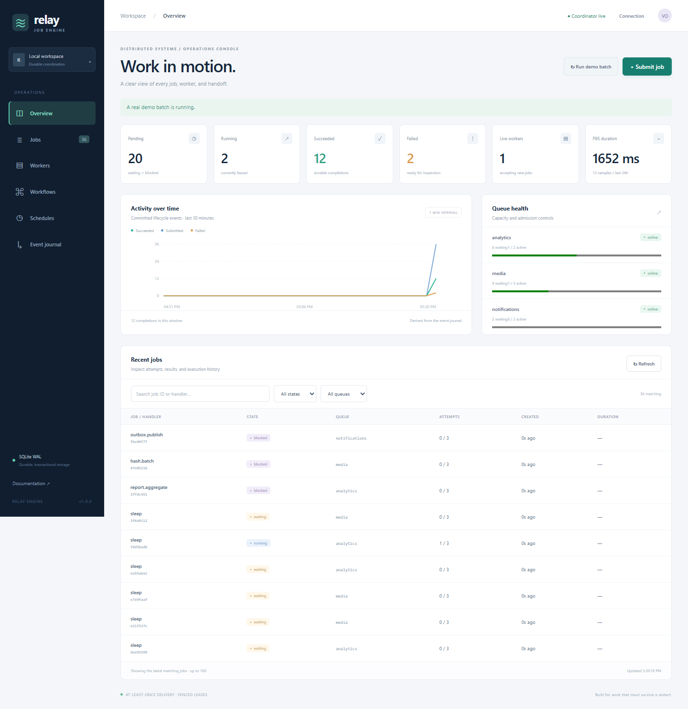

# Distributed Job Engine / Relay

A durable Node.js 24 job coordinator with remote HTTP workers and an operations console. SQLite WAL transactions serialize claims; attempt tokens fence expired workers. Delivery is at least once.

## Start

Requires Node.js 24 or newer. Run npm ci, then npm start. Open http://127.0.0.1:4177. The demonstration creates real persisted jobs, an executing worker, retries, a workflow and a schedule. Data lives in data/engine.db.

For an empty coordinator use npm run serve. In another terminal run npm run worker -- --queues default --capacity 4. Workers can connect to another coordinator with --url. Set ENGINE_TOKEN on both ends for authenticated deployments; non-loopback binds require a token of at least 24 characters.

## Features

- Durable priority/delayed queues, capacity limits, admission backpressure and fixed-window claim rates.
- Fenced leases, renewable heartbeats, execution deadlines, bounded retries, dead-letter replay and crash recovery.
- Atomic DAG workflows, joins, cancellation propagation, interval/UTC cron schedules and bounded catch-up.
- Isolated handler threads, memory limits, custom handler modules, graceful worker draining and standalone HTTP workers.
- Transactional outbox, leased delivery acknowledgements, trace lineage, annotations, metrics, backups and explicit retention.
- Live console with admission forms, job inspection, worker controls, workflow graphs, schedules and journal polling.

## Verify

Run npm test, npm run benchmark, npm run format:check and npm run package:check. Install Chromium with npx playwright install chromium, then run npm run test:browser. BROWSER_EXECUTABLE can select an installed Chromium-compatible browser.

Read [architecture](docs/ARCHITECTURE.md), [API](docs/API.md), [operations](docs/OPERATIONS.md), [worker guide](docs/WORKERS.md), [delivery semantics](docs/SEMANTICS.md), [validation](docs/VALIDATION.md) and [limits](docs/LIMITATIONS.md). MIT licensed. Runtime has no third-party dependencies.
